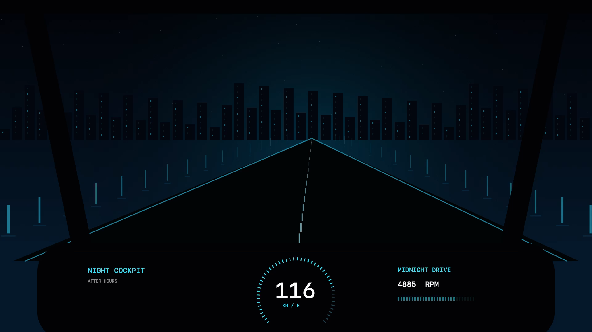

# Night Cockpit

A native macOS video wallpaper: your local video loops silently below Finder icons, stays out of mouse and trackpad input, and resumes after unlocking. A frame from the same video is installed underneath the player so startup, Spaces transitions, and decoder recovery keep the Night Cockpit background.

An original night-driving demo with synthesized audio is included, so a fresh download runs without finding media first. The app also accepts your own MP4 or MOV. It runs locally, with no browser, Homebrew, Python, media service, or runtime network dependency.



## Install with one command

[Download the source ZIP](https://github.com/rk-tanikonda/NightCockpit/archive/refs/heads/main.zip), extract it, open Terminal in the extracted folder, and run:

```bash
bash setup.command
```

Setup builds and installs `~/Applications/Night Cockpit.app`, uses the bundled demo on a fresh installation, and enables login startup. It keeps a valid video you already selected when updating. The installed demo is loaded from the app bundle, so deleting the downloaded source folder does not break playback.

Apple's Command Line Tools are a one-time prerequisite. If they are missing, run `xcode-select --install`, finish Apple's installation, then run setup. No paid developer certificate or administrator access is required by Night Cockpit's installer.

| Mac | Default setup |
| --- | --- |
| macOS 13–15, Intel or Apple Silicon | Muted animated desktop |
| macOS 26+, Intel or Apple Silicon | Desktop plus native Lock Screen video and synchronized sound |

Native playback uses an undocumented macOS extension protocol. Build checks run on Intel and Apple Silicon; actual Lock Screen playback has been manually verified on Apple Silicon/macOS 27. OS updates can require compatibility fixes, and build checks are not a guarantee for every Mac/OS combination.

On supported Macs the default setup keeps the display on while locked, as long as Night Cockpit's native mode is active. This uses more battery. To follow normal display sleep instead:

```bash
bash setup.command --allow-display-sleep
```

For desktop playback only:

```bash
bash setup.command --desktop-only
```

To use your own permitted video instead of the demo:

```bash
bash setup.command --video "$HOME/Movies/wallpaper.mp4"
```

Commands locate their own source folder and support spaces in paths. Relative video paths resolve from the caller's directory. Externally selected videos must stay at their chosen location. To build and launch without installing login startup, use `bash build.command`.

## Native Lock Screen

On macOS 26+, setup enables the same video as the native wallpaper and screen saver automatically. You can also request native mode explicitly:

```bash
bash setup.command --video "$HOME/Movies/wallpaper.mp4" --lock-screen
```

You can also choose **Apply video to Lock Screen** from the app menu. The installer registers a native wallpaper extension and stages a private copy of your local movie. The extension uses one AVQueuePlayer for both original tracks, preserving their timing and looping together at normal speed. There is no separate audio helper. Toggle **Sound while locked** in the menu; sound stops on unlock or sleep.

Native configuration uses undocumented per-user wallpaper files and an undocumented extension protocol, so it remains experimental and may need updates when macOS changes. Original choices are backed up, and every explicit Space/display choice and the global screen saver selection are checked after applying. Close the Wallpaper settings pane before applying your video so it cannot write stale settings back.

At startup and after unlock/Space changes settle, the app repairs a lost registration using the prepared local copy. It does not restart wallpaper services during locking. The native extension retains one player across lock cycles; the desktop keeps its own muted player. No network service or media download is used.

Test several lock/unlock cycles using **Control-Command-Q**, including the loop boundary. macOS controls the screen saver, authentication background, and display sleep; the app never places a window over authentication UI. Video may become still when macOS dismisses the screen saver for input. Device rendering and gesture behavior require a real Mac check.

## Controls and commands

| Command | Result |
| --- | --- |
| `bash service.command status` | Inspect the login service |
| `bash service.command stop` | Stop playback/startup and restore our background/native choices |
| `bash service.command start` | Build, install, and enable startup |
| `bash service.command restart` | Restart the installed app |
| `bash service.command uninstall` | Remove login startup while preserving app, video, and backups |
| `bash lockscreen.command status` | Inspect native selection and shared-clock movie |
| `bash lockscreen.command repair` | Repair the selected native provider without re-encoding |
| `bash lockscreen.command restore` | Restore our native choices while preserving later user changes |
| `bash build.command --build-only` | Build without launching |
| `bash check.command` | Run development checks and build without installing |

Stopping restores the previous background while preserving the chosen native-mode and sound preferences for the next start. Use `lockscreen.command restore` to explicitly disable native mode.

Every command supports `--help`. The menu provides pause, fit, display selection, video selection, and stop. For wallpaper clicks to move other windows aside, set **System Settings → Desktop & Dock → Click wallpaper to reveal desktop → Always**. The app passes clicks through to macOS.

The app retains its player and last frame across lock/wake and reuses windows when displays change. Wallpaper windows reject input/focus, stay at desktop level, and remain visible as a live background during Mission Control/App Exposé while macOS handles desktop selection. They do not get raised on app or Spaces changes. The native setup enables **Keep display awake while locked**; turn this off in the menu or use `--allow-display-sleep` to follow macOS display sleep. This uses more battery; unlock, explicit sleep, stopping, or quitting releases the hold. It does not change power preferences or authentication settings.

Logs live in `~/Library/Logs/NightCockpit/`. Prepared posters, source metadata, and restore backups live in `~/Library/Application Support/NightCockpit/`. Do not delete that directory if you want to restore your previous wallpaper.

## Configuration and development

Local video paths stay in per-user preferences. The original CC0 demo at `Videos/wallpaper.mp4` is tracked and copied into the app. Other personal media stays ignored by Git. See [media source](Videos/SOURCE.md) and [media license](MEDIA_LICENSE.md). Streaming and WebKit are intentionally absent.

Development tests require Node.js 18+; the app does not:

```bash
bash check.command
```

Checks cover portable command behavior, native selection/restore, movie metadata parsing, lifecycle transitions, noninteractive window properties, build resources, and signing. They do not change wallpaper settings or install a service. Window fixtures need a desktop session and report a skip when one is unavailable.

See [Architecture](docs/ARCHITECTURE.md), [Testing](docs/TESTING.md), and [Contributing](CONTRIBUTING.md). Use Issues and Pull Requests for bugs and changes. Include macOS version and relevant errors; redact private paths and links.

## License

Original source and documentation are [MIT licensed](LICENSE). The native settings model includes Apache-2.0 adaptations; see [third-party notices](THIRD_PARTY_NOTICES.md). The bundled original demo video and audio are [CC0 1.0](MEDIA_LICENSE.md). User-supplied footage is not covered by the source licenses. The third-party Formula One clip used in local development is not distributed; the included demo is a different, original clip.
